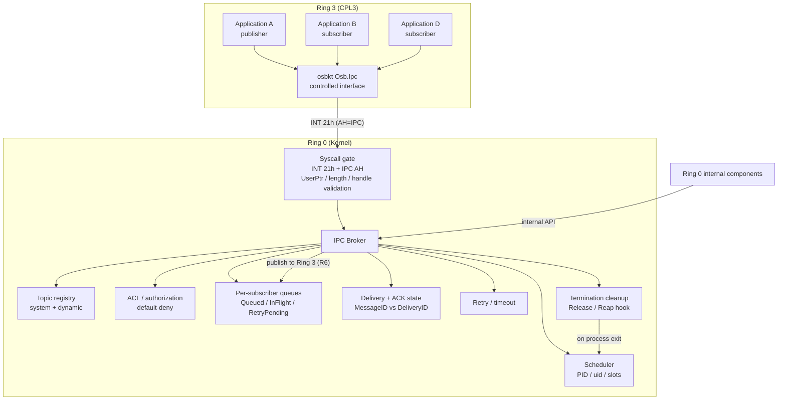
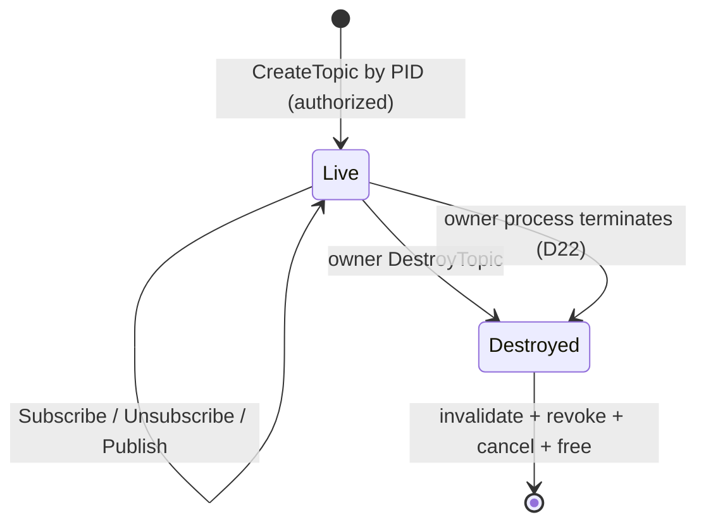
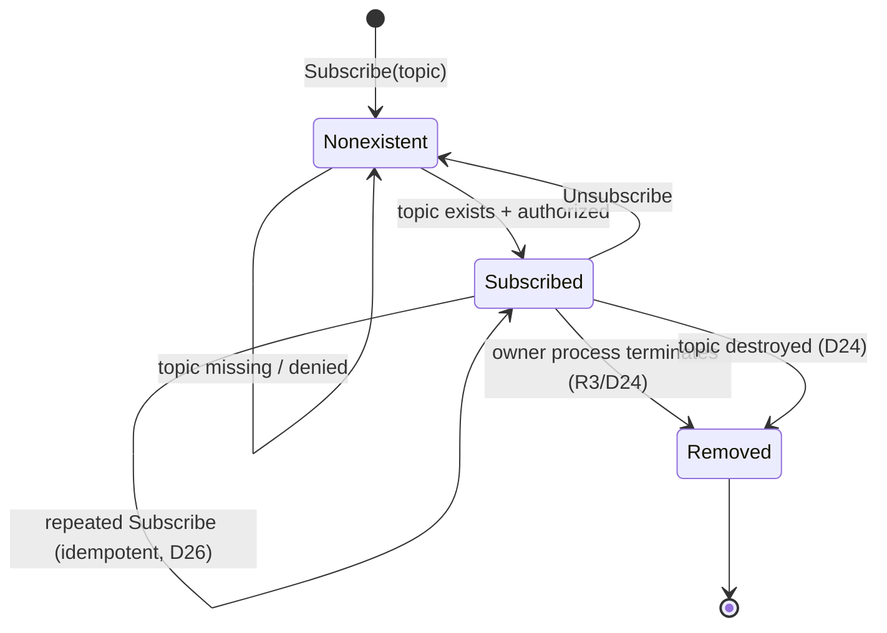
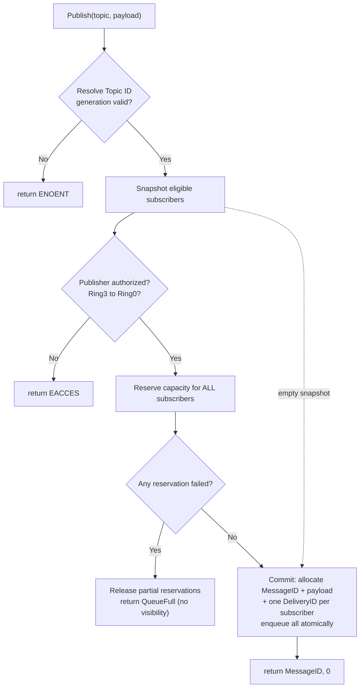
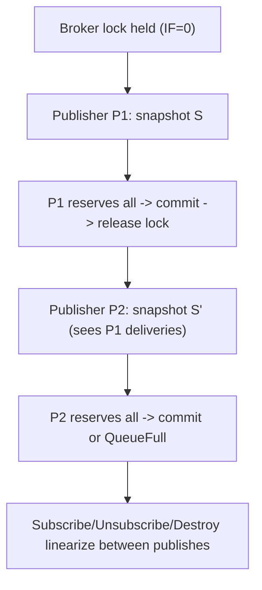
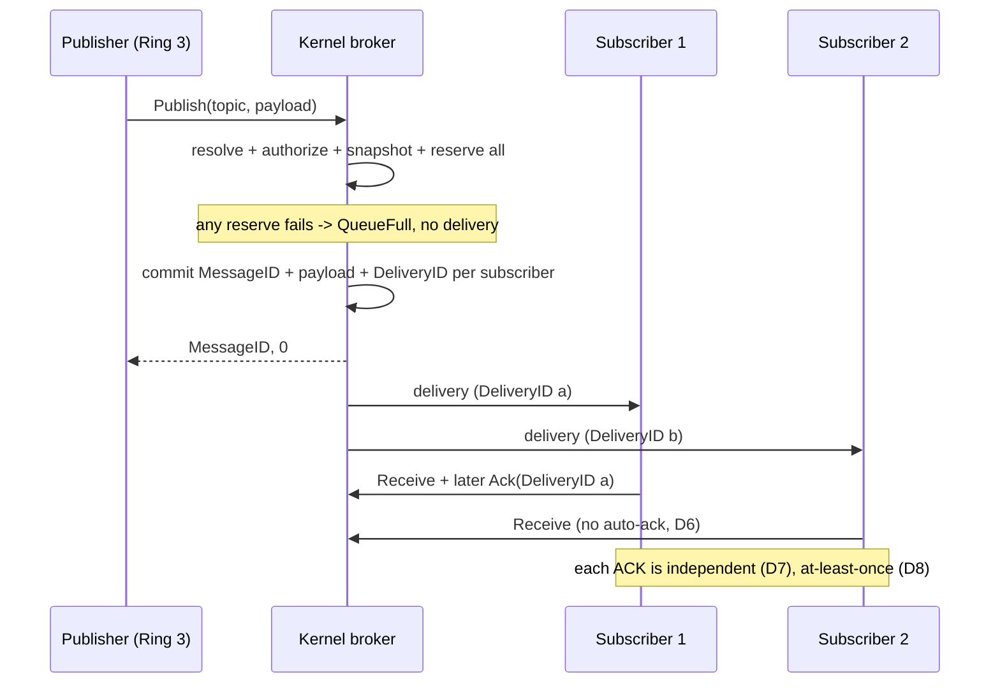
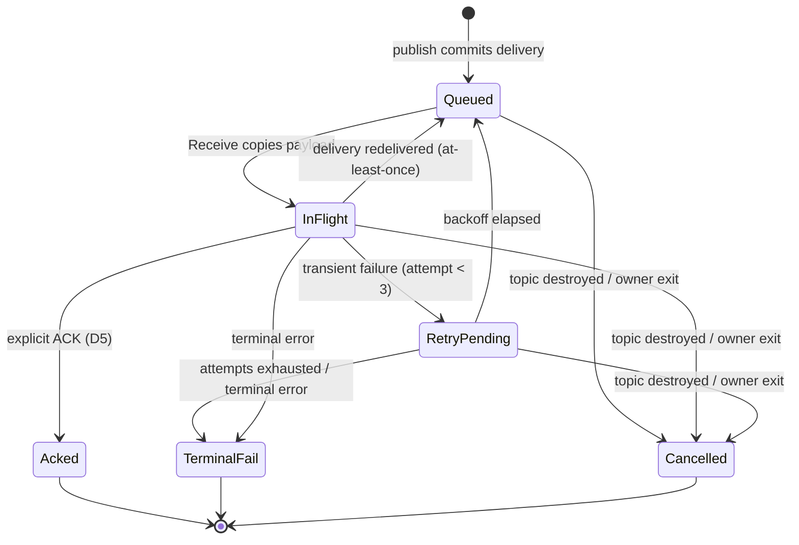
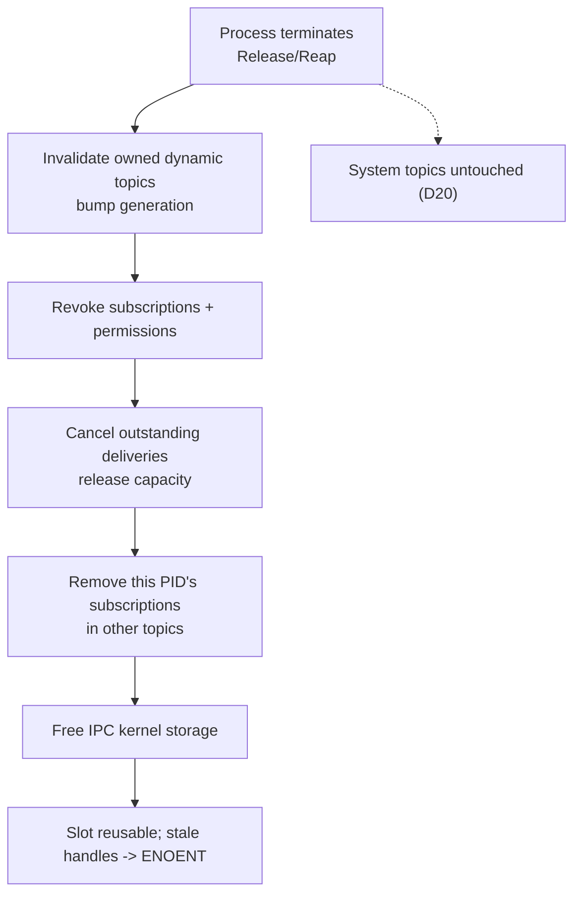

# OSB IPC Architecture and Requirements

**Card:** 3.1 — Define OSB IPC and messaging architecture and requirements
**Document type:** Architecture specification (design milestone)
**Status:** Specification / requirements — **not** an implementation and **not** a final ABI contract
**Audience:** OSB kernel, osbkt, and services implementers; project owner for open decisions

---

## 0. How to read this document (status labels)

Every statement is tagged so that implemented behavior, normative specification,
confirmed decisions, proposals, and open questions are never confused:

| Label | Meaning |
|---|---|
| **[IMPLEMENTED]** | Verified in source today (evidence cited as `path:line`). |
| **[NORMATIVE]** | An existing authoritative specification (e.g. `osbkt/docs/ABI.md`, OSLANG spec). |
| **[DECIDED]** | Explicitly confirmed by the project owner for Card 3.1 (Section 2). |
| **[PROPOSED]** | A design recommendation. Not final; needs an explicit owner decision. |
| **[OPEN]** | An unresolved question. Options, trade-offs, and a recommendation are given; the owner decides. |

**This document does not implement anything.** It does not change the kernel, osbkt,
syscall numbers, or the ABI version. Where it names syscalls, handles, or structs,
those are **[PROPOSED]** shapes to be ratified before any code is written.

---

## 1. Objective and scope

### 1.1 Objective

Define a technically rigorous, internally consistent IPC architecture for OSB that:

1. Adopts **Publish/Subscribe** as the official messaging model **[DECIDED]**.
2. Places the **IPC broker and message routing in the Kernel (Ring 0)** **[DECIDED]**.
3. Exposes IPC to Ring 3 **only through osbkt** **[DECIDED]**.
4. Satisfies the confirmed semantics in Section 2 without weakening the existing
   requirements in Section 3.
5. Provides measurable acceptance criteria (Section 14) so a later implementation
   card can be built and validated without re-litigating the design.

### 1.2 In scope

- Component responsibilities and Ring 0 / Ring 3 boundaries.
- Topic registry, ownership, ACLs, and authorization.
- Subscription lifecycle and uniqueness.
- Atomic publish, per-subscriber delivery, explicit ACK, at-least-once delivery.
- Retry/timeout/failure semantics, backpressure, quotas.
- Payload ownership and memory model.
- Ordering, synchronization, lock ordering, scheduler integration.
- Process termination and cleanup.
- Failure taxonomy, test strategy, sequencing.

### 1.3 Out of scope (strict non-goals for this card)

- Implementing the IPC runtime or any broker/queue code.
- Modifying kernel or osbkt runtime behavior.
- Changing syscall numbers or the ABI version.
- Introducing new public APIs as implemented contracts.
- Integrating Daemon Manager / daemon or module systems.
- Claiming functional IPC validation.
- Closing Card 3.1 or marking its subtasks complete.

---

## 2. Confirmed architectural decisions **[DECIDED]**

These are fixed inputs from the project owner. Implementation must conform; it must
not silently reinterpret them.

### 2.1 Messaging and delivery

- **D1** Publish/Subscribe is the official IPC messaging model.
- **D2** The Kernel owns the IPC broker and message routing.
- **D3** Ring 3 applications use osbkt for all IPC operations.
- **D4** Ring 3 cannot publish to Ring 0 destinations.
- **D5** ACK is explicit and controlled by the consuming application.
- **D6** Receiving or copying a message through osbkt does **not** automatically acknowledge it.
- **D7** Each subscriber has an independent logical delivery and ACK state.
- **D8** Delivery is **at-least-once**. Exactly-once processing is **not** promised.

### 2.2 Atomic publication

- **D9** Publish is atomic across all eligible subscribers.
- **D10** If any eligible subscriber queue cannot accept the delivery, the **entire publication is rejected**.
- **D11** No partial fan-out is allowed.
- **D12** `QueueFull` must be an explicit result.
- **D13** Publishing must not block indefinitely waiting for queue capacity.

### 2.3 No subscribers

- **D14** Publishing to an **existing** topic with no eligible subscribers **succeeds and is discarded**.
- **D15** No message retention or replay is provided.
- **D16** A subscription created after a publication does not receive that earlier message.
- **D17** Publishing to a **nonexistent** topic is different and must return an appropriate error.

### 2.4 Topic registry

- **D18** The topic registry is owned by the Kernel.
- **D19** The topic model is hybrid: reserved Kernel-managed system topics **and** dynamically created application topics subject to authorization.
- **D20** System topics are **not** owned by service PIDs.
- **D21** Dynamic topic ownership is associated with the creator's **actual PID**, obtained by the Kernel (never supplied by Ring 3).

### 2.5 Dynamic topic lifetime

- **D22** A dynamic topic is automatically destroyed when its owner process terminates.
- **D23** No orphaned topic and no automatic ownership transfer in the initial model.
- **D24** Cleanup must invalidate the topic, revoke its subscriptions/permissions, cancel outstanding deliveries, and release resources.

### 2.6 Subscription uniqueness

- **D25** At most **one** subscription per `(PID, Topic ID)` pair.
- **D26** Repeated `Subscribe` by the same process for the same topic must not create duplicate delivery streams or independent queues.

---

## 3. Existing requirements that must be preserved

The Card 3.1 description also establishes the following. They are treated as
binding requirements and verified against the architecture in Section 4.

- **R1** Up to **three** total delivery attempts for transient failures.
- **R2** Unique message identity and consumer-side deduplication.
- **R3** Subscriptions belong to their creating process and are removed on process termination.
- **R4** Kernel-derived process identity; Ring 3 cannot forge source identity.
- **R5** osbkt is the controlled Ring 3 interface.
- **R6** The Kernel may publish to Ring 3 and communicate internally with Ring 0 components.
- **R7** IPC must precede integrated Daemon Manager/daemon and module-system implementation.

Verification summary (details in Section 4): R3 and R4 are directly supported by the
current scheduler/PID model **[IMPLEMENTED]**; R5 is the current architecture
**[NORMATIVE]**; R1/R2/R6/R7 are new contracts this spec introduces **[PROPOSED]**
and do not conflict with existing code. None are weakened here.

---

## 4. Existing architectural constraints and evidence

These are properties of the current OSB implementation that any IPC design must
respect. Each is **[IMPLEMENTED]** unless noted, with source evidence.

### 4.1 Single-core, no SMP synchronization

**[IMPLEMENTED]** The system is single-core and makes no SMP safety claim.
`osb.kernel/Processes/EmbeddedRegistry.cs:9-13` states the registry "is single-core
only and makes NO SMP safety claim"; `EmbeddedRegistry.Leases.cs:5-6` repeats it.
There is no APIC/SMP bring-up in the kernel source.

**Consequence for IPC:** "atomic" and "linearizable" mean *with respect to the
single CPU and timer-driven preemption*, not with respect to multiple cores. A
critical section that disables interrupts is atomic against preemption.

### 4.2 SpinLock M0 primitive

**[IMPLEMENTED]** `osb.kernel/Sync/SpinLock.cs` provides a minimal, interrupt-safe,
single-core spinlock:

- Acquisition saves RFLAGS and disables interrupts (`osb_save_and_cli`), then
  spins on an atomic CAS (`osb_spinlock_cas`) — `SpinLock.cs:53-60`.
- Release clears the lock **before** restoring IF — `SpinLock.cs:64-68`.
- **Recursive acquisition of the same lock is prohibited** (deadlock on one CPU) —
  `SpinLock.cs:16`.
- **IRQ/NMI/SMI handlers must not acquire M0 locks** — `SpinLock.cs:17`.
- Nested acquisition of **distinct** locks is supported — `SpinLock.cs:18-19`.
- SMP correctness is **not** claimed — `SpinLock.cs:20-21`.

**Consequence for IPC:** the broker lock is an M0-style interrupt-safe lock. The
publish reservation/commit critical section must be bounded and must not call into
code that acquires the same lock recursively, and must not run inside an IRQ.

### 4.3 Fixed task table (8 slots)

**[IMPLEMENTED]** `osb.kernel/Memory/Layout.cs:162` sets `TaskCount = 8`
(console + 7 process slots). `Scheduler.cs:53-90` defines the fixed `TaskTable`.
`AllocSlot()` scans slots 1..7 (`Scheduler.cs:188-193`).

**Consequence for IPC:** the number of concurrently live Ring 3 processes (and thus
potential distinct subscriber PIDs) is bounded by 7 today. The design must not
assume an unbounded process population; per-subscriber state is bounded by the live
task set plus system/Kernel subscribers.

### 4.4 Kernel-owned 64-bit PID, never reused

**[IMPLEMENTED]** `osb.kernel/Processes/PidAllocator.cs`:

- PID is `ulong`; `FirstPid = 1`, `MaxPid = ulong.MaxValue` — `PidAllocator.cs:16-19`.
- Monotonic, **never reused within a boot**; exhaustion is explicit (no wrap) —
  `PidAllocator.cs:5-8, 51-63`.
- The console reserves PID 1 at init — `Scheduler.cs:152-154`.
- `GETPID` returns the full u64 — `Syscalls.Process.cs:11-14`; ABI v9 documents it
  (`osbkt/docs/ABI.md:9-27`).

**Consequence for IPC (R4, D21):** the Kernel derives the publisher/subscriber PID
from the task table (`Scheduler.Get(slot).Pid`), never from a Ring 3-supplied value.
A PID is a stable identity for the life of a process and is not recycled, so a
stale PID cannot be confused with a new process within the same boot.

### 4.5 Private per-process address spaces; no shared memory

**[IMPLEMENTED]** `osb.kernel/Processes/AddressSpace.cs`:

- Each Ring 3 process gets a private 2 MiB block mapped at `UserBase`
  (`AddressSpace.cs:34-55`); page tables copy the kernel PDPT and retarget only
  `pd[16]` (`AddressSpace.cs:57-96`).
- The kernel half stays supervisor-only (U/S=0) — `AddressSpace.cs:70-71`.
- `UserBase = 0x2000000`, `UserLimit = 0x2200000` — `Layout.cs:42-43`.
- MEMGROW adds up to 8 blocks (16 MiB) per process — `Scheduler.cs:46-51`,
  `Scheduler.Memory.cs`.

**Consequence for IPC (Section 7.12):** there is **no shared-memory primitive** and
Ring 3 cannot read kernel memory. A "shared immutable kernel payload" can live in
kernel frames, but each subscriber must receive a **copy** into its own user window
on `Receive` (copy-on-receive), unless a new shared-page mapping facility is built
(open question Q-M1).

### 4.6 Kernel allocator and frame allocator

**[IMPLEMENTED]** `Kernel.cs:199-218` `OsAlloc`/`OsFree` round byte requests to
whole frames from `PhysicalMemory` (bitmap allocator, `PhysicalMemory.cs`). The
kernel is identity-mapped, so physical == virtual inside Ring 0.

**Consequence for IPC:** the broker allocates topic/delivery/queue/payload storage
with `OsAlloc`/`OsFree`. Allocation failure is a first-class result (`ENOMEM`),
never a fault.

### 4.7 Syscall/ABI conventions (INT 21h)

**[NORMATIVE]** `osbkt/docs/ABI.md` (v9) is the ABI source of truth:

- Gate `INT 21h`, function in **AH**, args in **RDI/RSI/RDX/RCX**, result in **RAX** —
  `ABI.md:145-157`.
- Pointers validated with `UserPtr` (overflow-safe, A7) — `ABI.md:176-183`;
  kernel implementation `Syscalls.cs:127-135`.
- Strings are **byte strings with explicit length** (B1) — `ABI.md:168-175`.
- Error codes: `-1` EFAULT, `-2` ENOSYS, `-3` EACCES, `-4` ENOENT, `-5` EINVAL,
  `-6` ENOMEM, `-7` EINTR, `-8` EBADF; `-1`/`-2` frozen — `ABI.md:159-167`.
- `AbiVersion = 9` — `Syscalls.cs:22`; `GETABI` (82h) — `Syscalls.Process.cs:162-165`.
- Dispatch table — `Syscalls.cs:24-96`; unknown function → ENOSYS (`Syscalls.cs:95`).

**[IMPLEMENTED]** Free AH values today include `0x02-0x08`, `0x0A-0x0F`,
`0x12-0x1F`, `0x2D-0x2F`, `0x31-0x3F`, `0x5A-0x5F`, `0x62`, `0x83-0xFF`
(derived from `Syscalls.cs:48-93` plus the GFX/terminal/identity/user partials).

**Consequence for IPC:** any IPC syscall is a **new** AH allocation that **bumps the
ABI version** (to v10) and updates `ABI.md` in the same change (P5). This spec
proposes numbers (Section 12) but does **not** allocate them.

### 4.8 Scheduler: preemptive round-robin, halt-based wait

**[IMPLEMENTED]** `Scheduler.cs`:

- 100 Hz PIT preemption; `Preempt()` round-robins ready slots — `Scheduler.cs:332-354`.
- `WaitFor(pid)` **busy-halts** in a loop until the child leaves Ready/Zombie —
  `Scheduler.cs:312-327`; there is **no wait-queue / wakeup primitive**.
- `ExitCurrent` marks Zombie and switches away — `Scheduler.cs:292-301`.

**Consequence for IPC (Section 7.16):** a blocking `Receive` needs a wait mechanism.
The design must specify whether Receive is blocking (needing a new wait/wakeup
primitive) or non-blocking (polling), and must not busy-halt the whole CPU. This is
open question Q-S1.

### 4.9 Process termination and reaping

**[IMPLEMENTED]** `Scheduler.Release(slot)` frees the address space and MEMGROW
blocks and clears the slot — `Scheduler.cs:264-280`, `Scheduler.Memory.cs:43-54`;
`Reap` collects the exit code then releases — `Scheduler.cs:283-288`; `KILL`
(6Ch) calls `Release` — `Syscalls.Process.cs:118-129`.

**Consequence for IPC (D22, D24, R3):** dynamic-topic and subscription cleanup must
hook into the same termination path (`Release`/`Reap`) so it runs exactly once per
process, before the slot is reused.

### 4.10 Credentials

**[IMPLEMENTED]** Per-task `uid`/`gid`/session — `Scheduler.cs:71-74`;
`CurrentUid()`/`CurrentGid()` — `Scheduler.Tasks.cs:17-20`; permission checks use
the session uid (ABI I3). Ring 3 cannot forge identity (R4).

**Consequence for IPC:** ACL checks use `Scheduler.CurrentUid()`/`CurrentGid()` of
the calling task, not a Ring 3 claim.

### 4.11 Ring 0 internal components / program registry

**[IMPLEMENTED]** `osb.kernel/Processes/EmbeddedRegistry.cs` is a session-scoped,
growable registry of program definitions with lease accounting, IDs monotonic from 1
and never reused — `EmbeddedRegistry.cs:1-20, 66-90`. This is the existing pattern
for a Kernel-owned, growable, ID-based registry.

**Consequence for IPC:** the topic registry should follow the same pattern
(growable descriptor array via `OsAlloc`, monotonic IDs, no internal pointers
escaping) rather than a fixed-size table.

### 4.12 OSLANG 0.8 handle note

**[NORMATIVE]** `osb.oslang/OSLANG-0.8-SPEC.md §2` states the language spec "must
not prescribe ... handle representation; index-plus-generation implementation," while
noting "the implementation architecture has separately selected index-plus-generation
handles."

**Consequence for IPC (Section 7.7, Q-H1):** index-plus-generation handles are an
established OSB implementation pattern and are a sound basis for Topic IDs and
Delivery IDs, but (matching OSLANG's separation) they are an **implementation**
choice, not a language/ABI guarantee.

### 4.13 Documentation conventions

**[NORMATIVE]** `osb.docs/CONTRIBUTING.md` requires status-aware, source-linked,
Markdown-first docs; `osb.kernel/OSB_ARCHITECTURE.md` is the authoritative
cross-repo architecture and uses the `[DECIDED]/[CURRENT]/[PROPOSED]/[OPEN]`
label scheme this document mirrors. The kernel `docs/` directory already hosts
focused subsystem documents (`osb.kernel/docs/FS-PRIMITIVES.md`).

---

## 5. Component architecture

### 5.1 Responsibilities

| Component | Ring | Responsibilities |
|---|---|---|
| **IPC Broker** (Kernel) | 0 | Owns topic registry, ACLs, subscription table, per-subscriber queues, atomic publish, delivery/ACK state, retry/timeout, cleanup, quotas. Derives identity from the task table. |
| **Kernel syscall gate** | 0 | Validates IPC requests (`UserPtr`, lengths, handles), invokes broker, returns ABI error codes. Allocates the IPC AH numbers (proposed) and bumps ABI. |
| **osbkt `Osb.Ipc`** | 3 | The only Ring 3 IPC surface: typed wrappers over the IPC syscalls; no direct `INT 21h` outside osbkt. Transport-agnostic public API. |
| **Ring 3 applications** | 3 | Publish/Subscribe/Receive/ACK via osbkt only. Cannot address Ring 0 destinations (D4). |
| **Ring 0 internal components** | 0 | Communicate with the broker through an internal API (not the Ring 3 ABI); may publish to Ring 3 (R6). |

### 5.2 High-level diagram



Ring 3 reaches the broker **only** through osbkt → syscall gate (D3, R5). The broker
derives identity from the scheduler (R4, D21). Ring 0 components use a separate
internal API and may publish into Ring 3 queues (R6).

---

## 6. Ring 0 / Ring 3 boundary and minimum syscall/ABI requirements

### 6.1 Boundary rules

- **B-1** All Ring 3 IPC enters via `INT 21h` with the function in AH **[NORMATIVE]**.
- **B-2** Every pointer argument is validated with `UserPtr` (overflow-safe) before
  any copy; a bad range returns `-1 EFAULT` and never faults Ring 0 **[NORMATIVE]**.
- **B-3** The caller PID is **never** taken from the request; the broker uses
  `Scheduler.Get(Scheduler.Current).Pid` **[IMPLEMENTED/R4]**.
- **B-4** Ring 3 may not name a Ring 0 destination; publishing to a Ring 0-only topic
  returns `-3 EACCES` **[DECIDED D4]**.
- **B-5** The IPC ABI is versioned with the rest of the ABI; adding IPC bumps
  `AbiVersion` and `ABI.md` together **[NORMATIVE P5]**.

### 6.2 Minimum syscall surface (proposed, not allocated) **[PROPOSED]**

A minimal set sufficient for the confirmed model (Section 12 gives full shapes):

| Operation | Purpose |
|---|---|
| `IPC_CREATE_TOPIC` | Create a dynamic topic (owner = caller PID). |
| `IPC_DESTROY_TOPIC` | Destroy a dynamic topic (owner or authorized). |
| `IPC_SUBSCRIBE` | Subscribe caller to a topic (idempotent per D25/D26). |
| `IPC_UNSUBSCRIBE` | Remove the caller's subscription. |
| `IPC_PUBLISH` | Atomic publish; returns `MessageID`, `0`, `QueueFull`, `ENOENT`, `EACCES`. |
| `IPC_RECEIVE` | Dequeue one delivery for the caller (blocking/non-blocking TBD, Q-S1). |
| `IPC_ACK` | Explicitly acknowledge a `DeliveryID` (D5). |
| `IPC_POLL` (optional) | Non-blocking status/queue-depth probe. |

No syscall number is assigned here. Candidate free range `0x83-0x8F` is noted for the
implementer; final allocation requires an ABI bump to v10 and an `ABI.md` update.

---

## 7. Topic registry, naming, namespaces, Topic IDs

### 7.1 Ownership and structure

- **[DECIDED D18/D19]** The registry is Kernel-owned and hybrid: **system topics**
  (reserved, Kernel-managed) and **dynamic topics** (application-created, authorized).
- **[PROPOSED]** Follow the `ProgramRegistry` pattern (`EmbeddedRegistry.cs`): a
  growable descriptor array allocated via `OsAlloc`, monotonic IDs from 1, never
  reused within a boot, no internal pointers escaping (Section 4.11).

### 7.2 Identity: Topic ID handles

- **[PROPOSED]** A **Topic ID** is an index-plus-generation handle (Section 7.7,
  Q-H1): the index locates a descriptor slot; the generation detects stale references
  after destroy/reuse. A destroyed-then-reused slot with an old generation returns
  `ENOENT`.
- **[OPEN Q-N1]** Exact naming grammar, case sensitivity, and maximum length are not
  yet fixed (Section 13).

### 7.3 System vs dynamic topics

| Aspect | System topic | Dynamic topic |
|---|---|---|
| Created by | Kernel at init | Application via `IPC_CREATE_TOPIC` |
| Owner | None (Kernel-managed) **[D20]** | Creator's actual PID **[D21]** |
| Lifetime | Survives any Ring 3 service restart **[IMPLEMENTED constraint: system topics must outlive services]** | Destroyed on owner termination **[D22]** |
| Creation authority | Kernel only | Subject to ACL **[D19]** |

**[PROPOSED]** System topics are a small, fixed, reserved set (e.g. kernel
lifecycle/log topics) whose IDs are stable for the boot. They are never owned by a
service PID, so a service crash does not destroy them (D20, and the requirement that
system topics survive service restart).

### 7.4 Dynamic topic lifecycle **[DECIDED D22/D24]**



A dynamic topic is `Live` only while its owner PID is alive. Owner termination or an
explicit destroy moves it to `Destroyed`, where the handle generation is bumped so
stale Topic IDs return `ENOENT` (Section 11.5, Q-H1).

---

## 8. Topic ownership, ACLs, authorization, default-deny

- **[DECIDED D21]** Dynamic topic ownership = creator's actual PID (Kernel-derived).
- **[RATIFIED — Card 3.1 Phase 3A.1; implementation BLOCKED on Q-A1] Security model:**
  - **Default-deny.** A subject may `Publish`, `Subscribe`, or `Manage` a topic only
    if an explicit ACL entry grants it. No implicit "creator can do anything" beyond
    the ownership operations in Q-A3.
  - **Permissions (initial):** `Publish`, `Subscribe`, `Manage` (create/destroy/
    grant). Initial ACL targets are **PIDs only** (Q-A2); uid/gid groups are a later
    extension.
  - **Ownership operations:** the owner may `Destroy` and may `Grant/Revoke` Manage
    (Q-A3, open).
  - **Ring 3 → Ring 0:** denied by default and always (D4).
  - **Kernel internal:** Ring 0 components bypass the ACL via the internal API (R6),
    but are still subject to topic existence checks.
- **[OPEN Q-A1]** ACL representation (per-topic table vs capability list) is not
  fixed; recommendation in Section 13.
- **Status (Phase 3A.1, verified against source):** The model above is **ratified**
  but **not implemented**. There is **no ACL representation** in the kernel — no
  per-topic grant table and no grant/revoke API exist (`Processes/Ipc*.cs` define
  only `OwnerPid`/`Flags`; a code search for `Acl`/`Grant`/`Revoke`/`Permission`
  returns nothing) — so explicit `Subscribe` grants **cannot be represented
  safely** yet (Q-A1 still open). Consequently the current v10 implementation does
  **not** enforce default-deny for `Subscribe`: any process may subscribe to any
  existing topic. Owner/kernel authorization **is** enforced for `Publish`
  (`Ipc.Publish.cs:32-33`) and `Destroy` (`Ipc.Registry.cs:51-52`). The open
  `Subscribe` is a **known deviation, not an approved grant**; per the milestone
  gate no partial ACL was invented. **Blocked pending Q-A1/A2/A3.**

Authorization is evaluated in the broker **using the caller's Kernel-derived uid/gid**
(Section 4.10), never a Ring 3-supplied identity.

---

## 9. Subscription lifecycle and uniqueness

### 9.1 Uniqueness **[DECIDED D25/D26]**

- At most one subscription per `(PID, Topic ID)`.
- Repeated `Subscribe` is **idempotent**: it must not create a second queue or a
  second delivery stream. **[OPEN Q-S2]** whether the repeat returns `0` (success)
  or a distinct `AlreadySubscribed` code — recommendation in Section 13.

### 9.2 Lifecycle



### 9.3 Process-owned **[R3]**

Subscriptions belong to the creating process and are removed on termination
(Section 11). Unsubscribe of a nonexistent subscription is **[OPEN Q-S3]**
(Section 13).

---

## 10. Publish semantics and atomic fan-out

### 10.1 Confirmed semantics

- **[DECIDED D9-D13]** Atomic across all eligible subscribers; any queue that cannot
  accept rejects the whole publication; no partial fan-out; `QueueFull` is explicit;
  never block indefinitely for capacity.
- **[DECIDED D14-D17]** Existing topic + zero eligible subscribers → success,
  discarded, no retention/replay; nonexistent topic → error (`ENOENT`).

### 10.2 Reservation-and-commit algorithm **[PROPOSED]**

All steps run inside one bounded, interrupt-disabled broker critical section
(Section 4.2). No blocking user-memory copy and no waiting on consumers occurs here.

1. **Resolve topic** by Topic ID handle; validate generation. Missing → `ENOENT`.
2. **Snapshot eligible subscribers** for the topic (those with an active
   subscription and `Subscribe` permission for the publisher).
3. **Authorize** the publisher (`Publish` permission / ownership / Ring 0 internal).
   Failure → `EACCES`. Ring 3 → Ring 0 destination → `EACCES` (D4).
4. **Reserve** capacity for **every** subscriber in the snapshot
   (Queued+InFlight+RetryPending accounting, Section 10.4). If **any** reservation
   fails → **abort**: release all partial reservations, return `QueueFull`, publish
   nothing (D10/D11).
5. **Commit**: allocate the `MessageID`, the immutable payload, and one `DeliveryID`
   per subscriber; enqueue each delivery; make them visible atomically.
6. **Return** `MessageID` and `0`. With an empty snapshot, commit an accepted
   message with **no deliveries** and return success (D14).

### 10.3 Atomic publish flow



### 10.4 Queue accounting **[PROPOSED, matches recommendation]**

- A delivery consumes subscriber capacity in **all** of `Queued`, `InFlight`, and
  `RetryPending` states.
- Capacity is released on **ACK**, **terminal failure**, **cancellation**, or
  **process termination** (Section 11).
- **[OPEN Q-Q1]** exact capacity unit (count vs bytes) and default depth — Section 13.

### 10.5 Concurrency and linearization

- **[PROPOSED]** The broker lock serializes `Publish`, `Subscribe`, `Unsubscribe`,
  `CreateTopic`, `DestroyTopic`, and cleanup, giving a single **linearization point**
  per operation (Section 10.3 commit).
- Concurrent publishers are serialized by the lock; each publish is atomic and
  independent (Section 7.14).
- A publish that races a `DestroyTopic` or a subscription change is ordered by the
  lock: either it linearizes before the change (and is delivered/cancelled per
  Section 11) or after (and observes the new state).

### 10.6 Concurrent reservation/commit under contention



Because the section is bounded and never waits on consumers, a slow consumer cannot
stall publishers (D13); it only causes its own queue to reject (QueueFull), which
aborts the whole publish (D10).

### 10.7 Publisher/subscriber sequence



---

## 11. Message ID vs Delivery ID; ACK; at-least-once; retry

### 11.1 Message ID vs Delivery ID **[PROPOSED]**

- **Message ID** identifies the original accepted publication. One per successful
  publish; unique for the boot; returned to the publisher.
- **Delivery ID** identifies **one subscriber-specific logical delivery** of a
  message. A fan-out of one message to N subscribers yields N distinct Delivery IDs.
- **A fan-out must not share one ACK state across subscribers** (D7): ACKing a
  Delivery ID affects only that subscriber's delivery.
- **[PROPOSED]** Retries **reuse the same Delivery ID** (Q-D1): the logical delivery
  is stable; only its attempt count/state changes. This keeps ACK and dedup stable
  across attempts.

### 11.2 Explicit ACK **[DECIDED D5/D6]**

- ACK is explicit and application-controlled; `Receive`/copy does **not** ACK.
- **[PROPOSED]** `ACK(DeliveryID)` is authorized to the subscription owner (the
  process that owns the queue). ACK of an unknown/foreign/already-ACKed Delivery ID
  returns an error (Q-D2).
- On ACK: release the delivery's capacity (Section 10.4) and mark it terminal.

### 11.3 At-least-once and deduplication **[DECIDED D8, R2]**

- Delivery is at-least-once: a delivery may be redelivered (e.g. after a crash
  before ACK). Exactly-once is not promised.
- **Consumer-side deduplication** is the consumer's responsibility, keyed by
  **Message ID** (R2). The broker guarantees Message ID uniqueness so dedup is
  well-defined.

### 11.4 Retry, timeout, terminal failure **[R1, PROPOSED]**

- Up to **three total delivery attempts** for **transient** failures (R1).
- **[PROPOSED] Failure classification:**
  - **Transient** (retryable): e.g. a temporary delivery error that is expected to
    clear. Retries reuse the Delivery ID; attempt count increments.
  - **Terminal** (non-retryable): e.g. permanent error or attempts exhausted. The
    delivery is cancelled, capacity released, and a terminal result is recorded.
- **[OPEN Q-T1]** exact transient-failure set, timeout, and backoff policy — Section 13.

### 11.5 Per-subscriber delivery/ACK lifecycle



Capacity is held in Queued, InFlight, and RetryPending; released on Acked,
TerminalFail, Cancelled (Section 10.4).

---

## 12. Payload ownership, memory, quotas

### 12.1 Payload ownership and immutability **[PROPOSED]**

- The published payload is copied once into **Kernel-owned, immutable** storage
  (`OsAlloc`) at commit; the publisher's user buffer is not retained.
- Each delivery record **references** the shared immutable payload (no per-subscriber
  copy in kernel memory).
- On `Receive`, the payload is **copied into the subscriber's user buffer**
  (copy-on-receive), because Ring 3 cannot read kernel memory (Section 4.5).

### 12.2 Shared immutable payload feasibility **[PROPOSED, with constraint]**

A single shared immutable kernel payload referenced by independent delivery records
is **feasible and safe** in kernel memory and is the recommended design. It is safe
because the payload is immutable and the kernel is single-core (Section 4.1). It does
**not** imply Ring 3 shared memory: each subscriber still receives a copy. A true
shared user page would require a new U/S=1 mapping facility (Q-M1) and is **not**
recommended for the initial model.

### 12.3 Memory and resource quotas **[PROPOSED]**

- Per-topic and per-subscriber capacity limits (count and/or bytes) bound memory.
- A per-boot cap on total IPC kernel storage prevents a single publisher from
  exhausting frames.
- Allocation failure maps to `ENOMEM` (never a fault).
- **[OPEN Q-M2]** maximum payload size and numeric quota defaults — Section 13.

---

## 13. Ordering, synchronization, scheduler, cleanup, failures

### 13.1 Ordering and concurrent publishers **[PROPOSED]**

- Per-subscriber, deliveries are ordered by **commit order** (the order publishes
  linearize). **[OPEN Q-O1]** whether cross-subscriber total order is guaranteed —
  recommendation: per-subscriber FIFO only; no global total order.
- Concurrent publishers are serialized by the broker lock; each publish is atomic.

### 13.2 Synchronization and lock ordering **[PROPOSED]**

- Single broker lock (M0-style, interrupt-safe, Section 4.2). Because it is one lock,
  there is no lock-ordering cycle **within** the broker.
- If a second lock is ever introduced, define a strict order and never acquire it
  inside an IRQ (Section 4.2).
- The critical section never: waits on consumers, copies to user memory, or calls a
  path that re-acquires the same lock (Section 4.2, D13).

### 13.3 Scheduler integration / Receive **[OPEN Q-S1]**

- The current wait is a busy-halt with no wait queue (Section 4.8). Options:
  - **(a) Non-blocking Receive** (returns `EAGAIN`/empty) — simplest, no scheduler
    change; busy-poll by apps.
  - **(b) Blocking Receive** with a new per-slot wait channel + wakeup on enqueue —
    more work, needs a scheduler primitive and careful IRQ-safety.
- **Recommendation:** start with (a) non-blocking + an optional `IPC_POLL`; add (b)
  only if profiling shows busy-poll is a problem. Owner decides (Q-S1).

### 13.4 Process termination and cleanup **[DECIDED D22/D24, R3]**

Hook cleanup into `Scheduler.Release`/`Reap` (Section 4.9) so it runs once per process:

1. Invalidate the process's dynamic topics (generation bump) → subsequent handles
   return `ENOENT`.
2. Revoke the topics' subscriptions and permissions.
3. Cancel outstanding deliveries (Queued/InFlight/RetryPending) owned by the exiting
   process and release their capacity.
4. Remove the process's subscriptions in **other** topics.
5. Release all IPC kernel storage for the process.

System topics are untouched (D20) and survive service restart.



### 13.5 Cleanup races

Because cleanup and publish/subscribe/receive/ack all take the broker lock, races are
serialized: an operation either linearizes before cleanup (and is then cancelled by
step 3/4) or after (and observes invalidated topics / removed subscriptions →
`ENOENT`). No operation holds a reference across the lock boundary.

### 13.6 Failure taxonomy and diagnostics **[PROPOSED]**

| Result | Meaning |
|---|---|
| `0` | Success. |
| `-1 EFAULT` | Bad pointer (A7). |
| `-3 EACCES` | Authorization denied / Ring 3→Ring 0 (D4). |
| `-4 ENOENT` | Nonexistent topic / stale handle / unknown subscription. |
| `-5 EINVAL` | Bad argument (length, handle shape). |
| `-6 ENOMEM` | Quota/allocation failure. |
| `-7 EINTR` | Interrupted (if blocking Receive is added). |
| `-8 EBADF` | Invalid handle (if handle-based). |
| `QueueFull` | Atomic publish rejected (D12); **explicit**, distinct from `ENOMEM`. |

Diagnostics must be **mechanism-only** (P1): the kernel records codes/counters; it
does not print user-facing messages.

---

## 14. Security model (summary)

- **Default-deny** ACLs; Kernel-derived identity (R4, D21); Ring 3 cannot forge PID
  or publish to Ring 0 (D4).
- Every pointer/length/handle validated in Ring 0 (A7, B-2).
- Payload copied in/out of user memory; no kernel pointer leaks to Ring 3.
- Quotas bound resource exhaustion; allocation failure is `ENOMEM`.
- No secrets cross the boundary; ACLs target PIDs initially (Q-A2).

---

## 15. API proposal (PROPOSAL — not a final ABI)

> **Everything in this section is [PROPOSED].** It is a shape to ratify, not an
> implemented contract. No syscall number or ABI version is changed by this document.

### 15.1 Ring 3 osbkt surface (illustrative)

```text
namespace Osb.Ipc

TopicId   CreateTopic(byte* name, int nameLen)          // -> handle / error
int       DestroyTopic(TopicId t)
int       Subscribe(TopicId t)                          // idempotent (D26)
int       Unsubscribe(TopicId t)
MessageId Publish(TopicId t, byte* payload, int len)    // 0 / QueueFull / ENOENT / EACCES
int       Receive(TopicId t, DeliveryId* out, byte* buf, int cap, bool block)
int       Ack(DeliveryId d)
```

### 15.2 Handle shapes (proposed) **[PROPOSED]**

- `TopicId`, `DeliveryId` = `{ uint index; uint generation; }` (index+generation,
  Section 4.12/Q-H1).
- `MessageId` = monotonic `ulong` (unique per boot).

### 15.3 Ring 0 internal API (proposed) **[PROPOSED]**

A separate internal entry (not the Ring 3 ABI) lets Ring 0 components publish to
Ring 3 and query broker state (R6). It shares the broker core but bypasses the
Ring 3 ACL (still subject to topic existence).

### 15.4 ABI impact when implemented (future)

Adding the IPC AH numbers bumps `AbiVersion` to **v10** and updates
`osbkt/docs/ABI.md` in the same change (P5). This card does not do that.

---

## 16. Open questions and recommendations

Each row is **[OPEN]**; the owner decides. Recommendations are starting points, not
decisions.

| ID | Question | Options / trade-offs | Recommendation |
|---|---|---|---|
| Q-N1 | Topic naming grammar, case sensitivity, max length | Free-form bytes vs restricted charset; case-sensitive vs insensitive (DOS-like is insensitive) | Restricted ASCII, case-insensitive, length ≤ 64; system topics use a reserved prefix |
| Q-N2 | Wildcard/prefix subscriptions vs exact match | Wildcards add routing complexity and ACL ambiguity | Exact-name only for v1; revisit with a routing need |
| Q-S2 | Repeated Subscribe result | `0` vs distinct `AlreadySubscribed` | Return `0` (idempotent); no new code |
| Q-S3 | Unsubscribe of nonexistent subscription | Error vs silent success | `ENOENT` (explicit, matches D17 spirit) |
| Q-A1 | ACL representation | Per-topic table vs capability list | Per-topic table keyed by PID (simple, Kernel-owned) |
| Q-A2 | ACL targets initially PIDs only? | PID-only vs uid/gid groups | PID-only for v1; groups later |
| Q-A3 | Can owners delegate Manage? | Yes vs no | Yes, owner may grant/revoke Manage to a PID |
| Q-D1 | Do retries reuse the Delivery ID? | Reuse vs new ID per attempt | **Reuse** (stable ACK/dedup) |
| Q-D2 | ACK of unknown/foreign/already-ACKed ID | Error variants | `ENOENT`/`EACCES`/idempotent-0 respectively (decide) |
| Q-M1 | Shared user page vs copy-on-receive | Shared page needs new U/S mapping; copy is simple | Copy-on-receive for v1 |
| Q-M2 | Max payload size and quota defaults | — | Propose 64 KiB max payload; per-subscriber depth 16; revisit by profiling |
| Q-T1 | Timeout/backoff and transient set | Fixed vs exponential backoff | Bounded exponential backoff, 3 attempts (R1); classify transient narrowly |
| Q-O1 | Ordering guarantee | Per-subscriber FIFO vs global total order | Per-subscriber FIFO only |
| Q-S1 | Blocking vs non-blocking Receive | Blocking needs a wait/wakeup primitive | Non-blocking + `IPC_POLL` for v1 |
| Q-H1 | Message/Delivery ID representation and exhaustion | u64 vs index+generation | MessageId u64 monotonic; DeliveryId index+generation; exhaustion → `ENOMEM` |
| Q-D3 | Consumer dedup responsibility | Broker vs consumer | Consumer, keyed by MessageId (R2) |
| Q-N3 | NACK necessity | Add NACK vs rely on timeout | No NACK in v1; timeout/terminal covers it |
| Q-R1 | Ring 0 internal API shape | Shared core vs separate entry | Separate internal entry over shared core (R6) |
| Q-ABI | Minimum syscall/ABI boundary | One IPC AH vs several | Several AHs in `0x83-0x8F`, ABI v10 |
| Q-SYNC | Scheduler/sync dependencies | Reuse M0 vs new primitive | Reuse M0 spinlock; add wait channel only if blocking Receive is chosen |

---

## 17. Test and acceptance strategy (measurable)

Acceptance is for a **future implementation card**; this card only defines it.

### 17.1 Functional

| # | Test | Expected |
|---|---|---|
| T1 | Publish to existing topic, 2 subscribers | Both receive; 2 distinct Delivery IDs; 1 Message ID |
| T2 | Publish with one full queue | Whole publish rejected `QueueFull`; **no** subscriber sees a partial delivery |
| T3 | Publish to existing topic, 0 subscribers | Success; message discarded; later subscriber gets nothing |
| T4 | Publish to nonexistent topic | `ENOENT` |
| T5 | Ring 3 publishes to Ring 0 topic | `EACCES` |
| T6 | Receive without ACK, then redeliver | At-least-once observed; ACK only on explicit call |
| T7 | ACK Delivery ID | Capacity released; only that subscriber affected |
| T8 | Repeated Subscribe same `(PID,Topic)` | One queue; no duplicate deliveries |
| T9 | Owner terminates | Dynamic topic invalidated; subscriptions revoked; deliveries cancelled; handles → `ENOENT` |
| T10 | System topic survives service restart | Topic and subscriptions persist |
| T11 | 3 transient failures | Exactly ≤3 attempts, then terminal; capacity released |
| T12 | Concurrent publishers | Each publish atomic; per-subscriber FIFO preserved |
| T13 | Stale Topic/Delivery handle after reuse | `ENOENT` (generation mismatch) |

### 17.2 Non-functional / invariants

- **N1** No kernel fault on any malformed request (bad pointer/length/handle) — `-1/-5/-8`.
- **N2** Publish critical section is bounded and never waits on a consumer (D13).
- **N3** No kernel pointer is ever returned to Ring 3.
- **N4** IPC storage is fully reclaimed on process exit and topic destroy (no leak).
- **N5** ABI version and `ABI.md` change together when IPC lands (P5).

### 17.3 Evidence for this card

This card is validated by **source evidence and document consistency only**. No
functional IPC validation is claimed (Section 1.3).

---

## 18. Dependencies and implementation sequencing

Per `OSB_ARCHITECTURE.md §13` and R7, IPC precedes Daemon Manager/module work. Suggested
sequence for the implementation card(s):

1. **Ratify open questions** (Section 16) — owner decisions.
2. **ABI allocation**: assign IPC AH numbers, bump to v10, update `ABI.md` (P5).
3. **Broker core**: topic registry (growable, `OsAlloc`), ACL, subscription table,
   per-subscriber queues, M0-locked atomic publish (reservation/commit).
4. **Syscall gate + osbkt wrappers**: validate, copy, return codes.
5. **Receive/ACK**: non-blocking first (Q-S1); blocking later if needed.
6. **Retry/timeout**, quotas, diagnostics.
7. **Cleanup hook** into `Release`/`Reap`.
8. **Tests** T1–T13, N1–N5.
9. **Only then**: first Ring 0 service extraction and Daemon Manager.

---

## 19. Evidence index

| Topic | Evidence |
|---|---|
| ABI conventions, v9, error codes | `osbkt/docs/ABI.md`; `osb.kernel/Cpu/Syscalls.cs:22,24-96,127-135` |
| 64-bit PID, never reused | `osb.kernel/Processes/PidAllocator.cs`; `Syscalls.Process.cs:11-14` |
| Task table (8 slots) | `osb.kernel/Memory/Layout.cs:162`; `Scheduler.cs:53-90,188-193` |
| Private address spaces, no shared mem | `osb.kernel/Processes/AddressSpace.cs`; `Layout.cs:42-43` |
| Kernel allocator | `osb.kernel/Kernel.cs:199-218`; `Memory/PhysicalMemory.cs` |
| Single-core, no SMP | `osb.kernel/Processes/EmbeddedRegistry.cs:9-13` |
| SpinLock M0 | `osb.kernel/Sync/SpinLock.cs` |
| Scheduler wait (busy-halt) | `osb.kernel/Processes/Scheduler.cs:312-327` |
| Termination/reap | `Scheduler.cs:264-301`; `Scheduler.Memory.cs:43-54` |
| Credentials | `Scheduler.Tasks.cs:17-20`; `Scheduler.cs:71-74` |
| Growable registry pattern | `osb.kernel/Processes/EmbeddedRegistry.cs:1-20,66-90` |
| Index+generation handles | `osb.oslang/OSLANG-0.8-SPEC.md §2` |
| Doc conventions | `osb.docs/CONTRIBUTING.md`; `osb.kernel/OSB_ARCHITECTURE.md` |

---

## 20. Non-goals (restated)

No IPC implementation, no kernel/osbkt runtime change, no syscall/ABI change, no new
implemented public API, no daemon/module integration, no functional IPC validation, and
no closure of Card 3.1 or its subtasks. This document is a specification only.